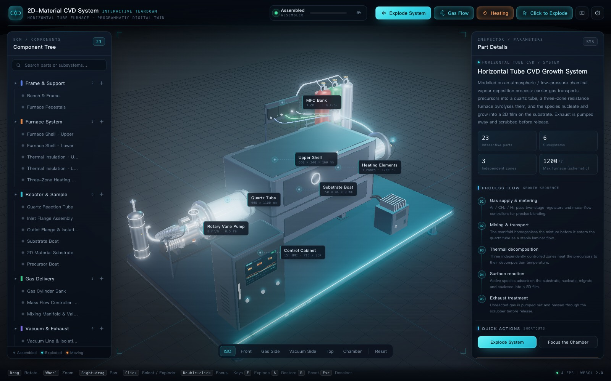
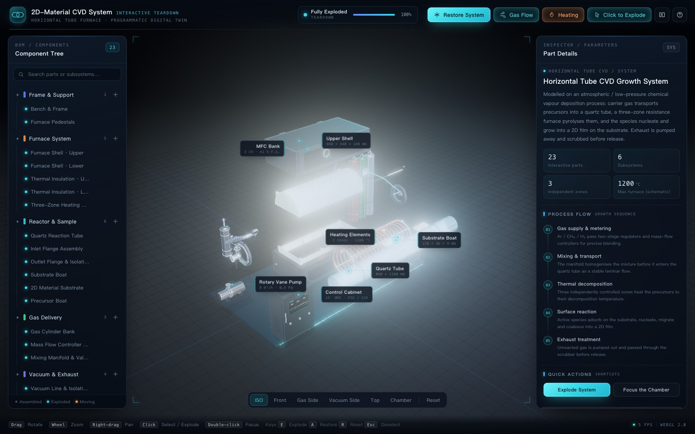
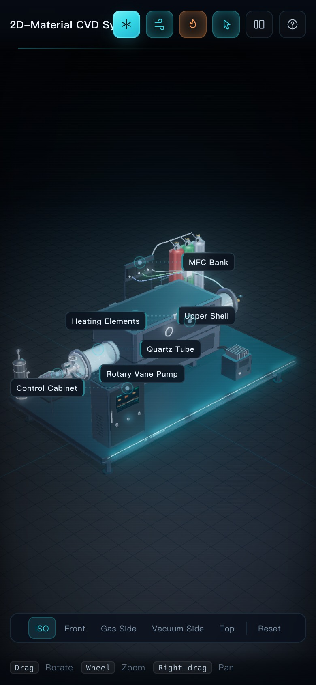

# CVD 二维材料生长设备 — 交互式三维拆解

[English](README.md) · **简体中文**

[**▶ 在线演示**](https://jiaqihriver.github.io/CVD-Visualizer/) · [**单文件版**](CVD-Visualizer.html) · [设计方案（PDF）](规划CVD可视化方案.pdf)

基于浏览器的实验室级 **化学气相沉积（CVD）** 设备三维交互拆解可视化。所有几何体、材质、标注与界面元素全部由代码程序化生成，**不加载任何外部 3D 模型文件**。

系统以水平管式炉 CVD（兼容 APCVD / LPCVD 结构）为原型，包含 **23 个可独立探索的部件**：石英反应管、分体式三温区加热炉、气瓶组、质量流量控制器、混气歧管、旋片真空泵、尾气处理罐、HMI 控制柜、热电偶、SCR 调功器等。

```
Three.js r186 · TypeScript 5.9 · HTML · CSS · Vite 7
```



| 选中部件 / 参数检查 | 整机爆炸视图 |
| --- | --- |
|  |  |

<p align="center">
  
</p>

---

## 1. 运行方式

### 方式 A — 在线演示

**https://jiaqihriver.github.io/CVD-Visualizer/**

### 方式 B — 双击打开（无需 Node、无需服务器）

用现代浏览器打开 **`CVD-Visualizer.html`**。

该文件是完整内联的独立构建：three.js、CSS 与全部应用代码都打包在一个 HTML 中，可直接从 `file://`、U 盘或邮件附件打开，只要求浏览器支持 **WebGL 2**。

> 若看到 “Unable to start the 3D scene” 提示，请查看 [第 6 节 故障排查](#6-故障排查)。

### 方式 C — 本地开发服务器

```bash
npm install
npm run dev            # http://localhost:5173
```

> 需要 Node.js 20.19+（见 `.nvmrc`）。Node 版本较低时请直接使用独立 HTML 文件。

### 方式 D — 生产构建

```bash
npm run build          # 输出 dist/（静态站点，部署该目录即可）
npm run preview        # http://localhost:4173
```

### 重新生成独立版 / Pages 版本

```bash
npm run build:single   # dist-single/index.html → CVD-Visualizer.html + docs/index.html
```

### GitHub Pages 部署

Pages 入口 `docs/index.html` 由 `npm run build:single` 生成并已提交到仓库。发布步骤：

**Settings → Pages → Source: Deploy from a branch → Branch 选择 `main` · Folder 选择 `/docs` → Save。**

随后即可通过 `https://jiaqihriver.github.io/CVD-Visualizer/` 访问。

---

## 2. 操作说明

| 操作 | 效果 |
| --- | --- |
| 左键拖动 | 自由旋转视角 |
| 滚轮 | 缩放 |
| 右键拖动 | 平移 |
| **单击部件** | 选中并拆解 / 复原（可在顶栏关闭 “Click to Explode”，改为仅选中） |
| **双击部件** | 相机平滑飞向该部件的无遮挡视角 |
| 悬停部件 | 柔和自发光高亮 + 跟随光标的提示 |
| 部件树 | 展开 / 折叠子系统、搜索、拆解、聚焦、显隐单个部件 |
| 子系统上的 **+** | 一键拆解 / 复原整个子系统 |
| **Explode System** | 分层错峰的整机爆炸视图，并自动调整取景 |
| 视角浮条 | 等轴测 · 正视 · 气路侧 · 真空侧 · 俯视 · 炉内 · 复位 |
| **Gas Flow** | 沿真实管路曲线流动的粒子动画 |
| **Heating** | 热区辉光、发热丝自发光与暖色点光源开关 |

快捷键：`E` 拆解整机 · `A` 复原 · `R` 复位视角 · `F` 聚焦选中部件 · `Esc` 取消选中 / 关闭引导 · `1–6` 切换预设视角。

调试参数：`?intro=0` 跳过入场引导；`?explode=1` 加载后自动拆解。

---

## 3. 已实现的功能

- **100% 程序化几何**：`ExtrudeGeometry` 圆角外壳、`LatheGeometry` 空心石英管（内外壁 + 环形端面）、半圆筒陶瓷纤维隔热层、螺旋电阻丝、`TubeGeometry` 气路、Canvas 贴图 HMI / MFC 屏幕与压力表盘。
- **分体炉体**：上下炉壳、上下隔热层沿真实装配方向分离，露出三温区螺旋加热丝与石英反应管。
- **可中断拆解动画**：每个部件独立维护进度、目标与延迟；时间归一化 `easeInOutCubic`；动画中途反向不会出现争抢位移。
- **按部件独立高亮**：注册器为每个部件克隆材质，悬停 / 选中 / 运动发光不会串到相邻部件；亮度经过收敛，保持材质可读且不刺眼。
- **屏幕空间标注**：由 3D 锚点投影的 HTML 标签，带引线、碰撞避让、跟随相机与拆解位移。
- **参数检查器**：部件编号、所属子系统、状态、规格表（尺寸 / 材料 / 温度 / 流量 / 压力 / 接口）、工作原理与安全提示，全部来自同一份数据文件。
- **工艺说明**：检查器默认视图展示五步生长流程；页面上所有按钮均有实际功能。
- **气流可视化**：粒子采样与管路几何完全相同的 Catmull-Rom 曲线，拆解时自动淡出。
- **响应式深色科技风界面**：玻璃面板、青色强调、暗角 / 扫描线叠加、状态与帧率 HUD；窄屏侧栏变为抽屉，竖屏手机会自动拉远取景以完整显示整机。

---

## 4. 项目结构

```
cvd-visualizer/
├── CVD-Visualizer.html          # ← 独立构建，双击即可运行
├── docs/                        # GitHub Pages 入口（由 build:single 生成）
│   ├── index.html               #    同一份独立构建
│   └── screenshots/             #    README 截图
├── index.html                   # 页面骨架（顶栏 / 面板 / 视角浮条 / 引导）
├── package.json
├── tsconfig.json
├── vite.config.ts               # build 与 build:single（内联）两种模式
├── scripts/copy-single.mjs      # 将单文件构建复制到根目录与 docs/
└── src/
    ├── main.ts                  # 启动、状态协调、渲染循环、AppActions
    ├── data/
    │   ├── equipmentConfig.ts   # 坐标轴、尺寸、气路曲线、视角预设
    │   └── cvdParts.ts          # 23 个部件：名称、规格、拆解偏移、标注锚点
    ├── core/
    │   └── SceneManager.ts      # 渲染器、相机、OrbitControls、灯光、PMREM、Bloom
    ├── models/
    │   ├── Materials.ts         # 共享 PBR 材质库
    │   ├── GeometryFactory.ts   # 圆角盒、空心管、管路、螺栓、仪表、Canvas 贴图
    │   ├── FrameBuilder.ts      # 机架、地脚、炉体支撑座
    │   ├── FurnaceBuilder.ts    # 分体炉壳、隔热层、三温区加热丝
    │   ├── ReactorBuilder.ts    # 石英管、法兰、基底舟、二维材料衬底
    │   ├── GasSystemBuilder.ts  # 气瓶组、MFC 机架、混气歧管
    │   ├── VacuumSystemBuilder.ts
    │   ├── ControlSystemBuilder.ts
    │   ├── CVDModelBuilder.ts   # 装配与注册
    │   └── GasFlow.ts           # 气流粒子
    ├── interaction/
    │   ├── PartRegistry.ts      # 部件运行时状态 + 材质克隆
    │   ├── ExplodeController.ts
    │   ├── HighlightController.ts
    │   ├── CameraAnimator.ts    # 缓动飞行、聚焦、自动取景
    │   └── InteractionManager.ts
    ├── ui/
    │   ├── UIController.ts      # 部件树、检查器、HUD、提示、快捷键
    │   └── AnnotationManager.ts
    ├── utils/easing.ts
    └── styles/                  # base / layout / panels / effects
```

### 坐标约定

- 1 单位 = 100 mm；台面上表面为 `z = 0`。
- `+X` 为反应管轴向（进气端 −X，排气端 +X）。
- `+Y` 为台面纵深（气路与真空组在 −Y，操作侧在 +Y）。
- `+Z` 为高度；相机 `up` 设为 `(0, 0, 1)`，OrbitControls 原生支持。

设备尺寸集中在 `equipmentConfig.ts`；部件名称、参数、拆解偏移与标注锚点集中在 `cvdParts.ts`。修改一处配置即可同时驱动模型、交互与界面。

---

## 5. 性能说明

- 1600 × 1000 下约 455 个网格、15 万三角面、含阴影通道约 600 draw call。
- 阴影仅对主要结构件开启（146 个投影体）；螺栓、屏幕与自发光体不投影。
- 像素比上限 1.5，页面不可见时暂停渲染。
- **自适应画质**：预热后帧率若持续低于 24 fps，会自动降低像素比，随后关闭 Bloom 与阴影（状态栏显示 `WEBGL 2.0 · ECO` / `SAFE`）。
- 几何体共享，材质仅在需要局部高亮时按部件克隆。
- 若浏览器回退到软件渲染（例如虚拟机），场景仍可运行但帧率较低——开启硬件加速可获得完整体验。

---

## 6. 故障排查

**提示 “Unable to start the 3D scene”**
浏览器未提供 WebGL 2。请开启硬件加速（Chrome → 设置 → 系统），更新显卡驱动，或改用较新版本的 Chrome / Edge / Safari / Firefox。

**打开 `index.html` 后白屏或报 CORS 错误**
源码版 `index.html` 通过 Vite 加载 TypeScript 模块，不能从文件系统直接打开。请改用 `CVD-Visualizer.html`，或运行 `npm run dev`。

**`npm run dev` 提示端口被占用**
运行 `npm run dev -- --port 5180`，或直接打开终端打印的地址。

**场景非常卡顿**
部分虚拟机使用 SwiftShader 软件渲染。请在浏览器中关闭 “使用软件渲染” / 开启 GPU 加速。

---

## 7. 免责声明

本项目中的全部尺寸、温度、流量与压力数值均为**教学示意值**，不代表任何真实仪器的额定规格。实际温度上限、石英管耐温、法兰密封、氢气安全联锁与尾气处理方案，必须以厂商铭牌、设备手册与实验室安全规程为准。

代码用于教学与演示，可自由修改与二次开发。三维模型为示意性重建，不包含任何厂商 CAD 数据。
